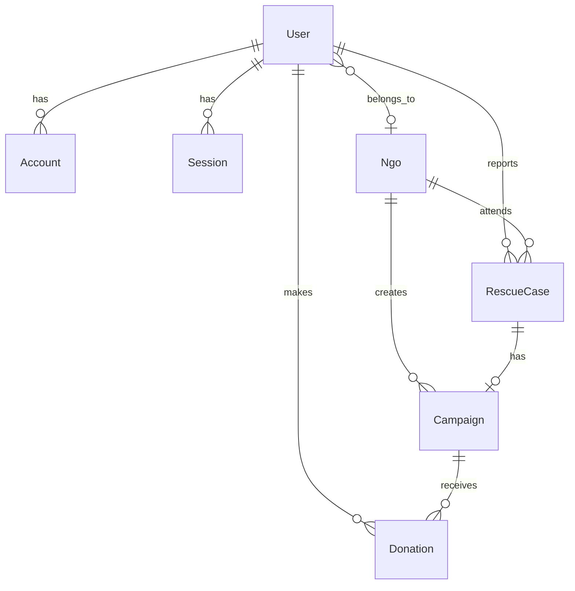

# Planejamento do Esquema Prisma (`prisma/schema.prisma`)

## 🎯 Objetivo
Projetar as entidades e relações no banco de dados PostgreSQL para suportar todas as features do **Guardiões da Fauna**.

---

## 🗺️ Diagrama de Relações (ER)



---

## 🗄️ Modelagem Planejada

### 1. Autenticação & Usuários (Extensão do schema atual)
```prisma
enum Role {
  CITIZEN
  VOLUNTEER
  NGO_ADMIN
  ADMIN
}

model User {
  id            String       @id @default(cuid())
  name          String?
  email         String?      @unique
  emailVerified DateTime?
  image         String?
  phone         String?
  city          String?
  state         String?
  role          Role         @default(CITIZEN)
  
  ngoId         String?
  ngo           Ngo?         @relation(fields: [ngoId], references: [id])
  
  accounts      Account[]
  sessions      Session[]
  rescues       RescueCase[]
  donations     Donation[]
  
  createdAt     DateTime     @default(now())
  updatedAt     DateTime     @updatedAt
}
```

### 2. ONGs Parceiras
```prisma
model Ngo {
  id          String       @id @default(cuid())
  name        String
  slug        String       @unique
  cnpj        String?      @unique
  description String
  logo        String?
  coverImage  String?
  phone       String
  email       String
  pixKey      String?
  city        String
  state       String
  isVerified  Boolean      @default(false)
  
  members     User[]
  rescues     RescueCase[]
  campaigns   Campaign[]
  
  createdAt   DateTime     @default(now())
  updatedAt   DateTime     @updatedAt
}
```

### 3. Resgates e Animais
```prisma
enum RescueStatus {
  REPORTED       // Registrado aguardando resgate
  IN_PROGRESS    // Voluntário/ONG a caminho ou em atendimento
  RESCUED        // Animal seguro e recebendo cuidados
  READY_ADOPTION // Recuperado e disponível para adoção
  RESOLVED       // Caso finalizado/adotado
}

enum UrgencyLevel {
  LOW
  MEDIUM
  HIGH
  CRITICAL
}

model RescueCase {
  id          String       @id @default(cuid())
  title       String
  description String
  species     String       // Cão, Gato, Silvestre, etc.
  urgency     UrgencyLevel @default(MEDIUM)
  status      RescueStatus @default(REPORTED)
  
  city        String
  state       String
  address     String?
  photos      String[]     // Array de URLs de imagens
  
  reportedById String
  reportedBy   User        @relation(fields: [reportedById], references: [id])
  
  assignedNgoId String?
  assignedNgo   Ngo?       @relation(fields: [assignedNgoId], references: [id])
  
  campaign     Campaign?
  
  createdAt   DateTime     @default(now())
  updatedAt   DateTime     @updatedAt

  @@index([city, state])
  @@index([status])
}
```

### 4. Doações e Campanhas
```prisma
enum CampaignStatus {
  ACTIVE
  COMPLETED
  CANCELLED
}

model Campaign {
  id            String         @id @default(cuid())
  title         String
  description   String
  goalAmount    Float
  currentAmount Float          @default(0)
  status        CampaignStatus @default(ACTIVE)
  
  ngoId         String
  ngo           Ngo            @relation(fields: [ngoId], references: [id])
  
  rescueCaseId  String?        @unique
  rescueCase    RescueCase?    @relation(fields: [rescueCaseId], references: [id])
  
  donations     Donation[]
  
  createdAt     DateTime       @default(now())
  updatedAt     DateTime       @updatedAt
}

model Donation {
  id            String       @id @default(cuid())
  amount        Float
  paymentMethod String       // PIX, CREDIT_CARD
  paymentStatus String       // PENDING, COMPLETED, FAILED
  
  campaignId    String
  campaign      Campaign     @relation(fields: [campaignId], references: [id])
  
  userId        String?
  user          User?        @relation(fields: [userId], references: [id])
  
  createdAt     DateTime     @default(now())
}
```
